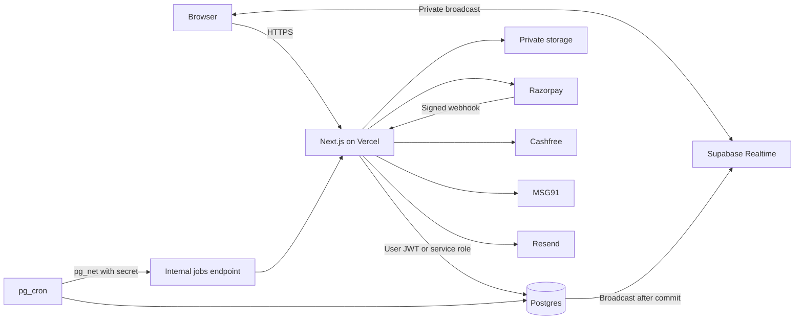

# Bid Market: Architecture

Source of truth: PRD.md and DESIGN.md. Decisions marked **[A-n]** in section 15 need your approval. PRD section 14 records which decisions the owner accepted and which stay open.

## 1. Summary

Bid Market is one web application backed by one Postgres database. There are no microservices, no separate message broker and no Redis in MVP.

The one hard technical problem is the auction. Bids must be ordered correctly, deadlines must be exact, and prices must reach only permitted people. The design handles this inside Postgres, in short transactions, so that one trusted component decides every outcome.

## 2. Tech stack

| Layer | Choice | Reasoning |
|---|---|---|
| Language | TypeScript 6.0, strict | One language across the stack, with strong types. Stay on 6.0 until the lint tooling supports 7. |
| Framework | Next.js 16.4, App Router | Combines public SEO pages, authenticated app and API. |
| Styling | Tailwind CSS with DESIGN.md tokens | Fast and consistent, with no runtime cost. |
| Fonts | Self-hosted through Fontsource packages | No request to Google from user browsers, and builds work without font network access. |
| UI primitives | Native HTML first, such as `dialog` and `details`. Add Radix UI only when a component needs it | Accessible behaviour with no extra dependency. |
| Validation | Zod | One schema shared by forms and API. |
| Database | PostgreSQL via Supabase | Transactions, row locks and row-level security solve the core problem. |
| Auth | Supabase Auth | Phone and password, OTP hooks, MFA and secure sessions. |
| Files | Supabase Storage. Private buckets for documents, and one public bucket for re-encoded product images | One vendor. Product images must display publicly. |
| Live auction updates | Polling every 3 seconds. Supabase Realtime is a later upgrade (decision 0009) | Each read runs through the same masked database function. |
| Scheduling | pg_cron and pg_net, plus a `jobs` table | No separate worker for MVP. |
| Payments | Razorpay Orders, Checkout and webhooks | RBI-authorised aggregator with India focus. [A-1] |
| Verification | Cashfree Secure ID | Covers PAN, GSTIN, GSTIN by PAN, bank account and CIN. [A-1] |
| SMS | MSG91 | Indian OTP delivery with DLT support. [A-1] |
| Email | Resend | Simple transactional API. [A-1] |
| Captcha | Cloudflare Turnstile | Low friction. |
| PDF | React-PDF, run in background jobs | No headless browser needed. |
| Errors | Sentry | Practical error tracking. |
| Hosting | Vercel in Mumbai (`bom1`), Supabase in Mumbai (`ap-south-1`) | Low latency to India. Confirm both regions at project creation. |

## 3. System overview



## 4. Frontend and backend architecture

The app is a **modular monolith**. Each business area owns its validation, service calls and UI.

**Frontend**

- Server Components fetch data for most pages. Public pages are cached with revalidation.
- Client Components exist only where needed: forms, filters and the live auction.
- The browser never writes to database tables.

**Backend**

Each request follows one path:

`Route handler → authenticate → validate with Zod → module service → Postgres function → audit and outbox → response`

**Golden rule.** Every state transition that affects money, bids, orders or status runs inside a single Postgres function. Route handlers do not contain business rules.

## 5. Folder structure

```text
/
├── app/
│   ├── (public)/            Marketing, catalogue, public tenders
│   ├── (auth)/              Sign up, log in, reset, OTP
│   ├── (app)/
│   │   ├── buyer/
│   │   ├── seller/
│   │   └── admin/
│   └── api/
│       ├── v1/              Application API
│       ├── webhooks/        Razorpay
│       ├── hooks/           Supabase Auth hooks
│       └── internal/        Job runner
├── modules/
│   ├── accounts/  catalogue/  orders/  tenders/
│   ├── billing/   documents/  support/  admin/
│   └── each contains schemas, service, queries, components
├── components/ui/           Design system components
├── lib/
│   ├── supabase/  auth/  errors/  money/  files/  crypto/  logger/
│   └── providers/           razorpay, cashfree, msg91, resend, turnstile
├── supabase/
│   ├── migrations/  seed/  tests/
├── tests/
│   ├── unit/  integration/  e2e/  load/
└── docs/                    PRD, DESIGN, ARCHITECTURE, DATABASE, API
```

AGENTS.md stays at the repository root.

## 6. Data flows

### 6.1 Direct order

1. The buyer submits an order. The server validates limits and creates an `unpaid` order with a fee charge.
2. Razorpay Checkout collects the fee, or the wallet covers it.
3. The signed webhook marks the payment paid. The order moves to `awaiting_seller`, and the fee moves to On hold.
4. The seller accepts and pays. Contact details unlock. The order moves to `accepted`.
5. The seller dispatches with documents.
6. The buyer confirms receipt with a photo. The order moves to `completed`, and held fees become Paid with tax invoices. PDFs are built on request.

### 6.2 Reverse auction bid

1. The seller posts a bid with an idempotency key.
2. `place_ra_bid` locks the tender row.
3. Inside the lock it checks server time, eligibility, block status and the decrement.
4. It appends the bid, updates L1 and bumps the sequence number. It extends the deadline if the anti-sniping rule applies.
5. The seller's client polls the auction every 3 seconds and picks up the new L1, rank and deadline.

The row lock gives one strict order per tender. The bid's commit under lock is the official bid time.

### 6.3 Closing and awarding

Every minute, pg_cron calls `tick_tenders` directly in the database (the `tender-deadlines` job), so deadlines do not depend on the web job runner or its secret. It finds tenders past their deadline. Bid acceptance never relies on this job. `place_ra_bid` checks `ends_at` itself, so a delayed job cannot admit a late bid. Between the deadline and finalisation, the page shows "Closed, confirming the result".

`tick_tenders` also applies extensions or cancellations, moves Bid to RA tenders from sealed bidding to shortlisting, starts their auction at the set time (keeping every sealed bidder if the buyer did not shortlist), and expires unanswered awards after the configured window. Decision 0010 has the Bid to RA rules.

## 7. Real-time design

**Current build:** polling only, under decision 0009. The channel design below is kept for the upgrade.

Two private channels exist for each live auction.

| Channel | Who may join | Payload |
|---|---|---|
| `ra:{tenderId}:sellers` | Sellers with a non-eliminated participant row | `seq`, `l1Paise`, `bidCount`, `endsAt` |
| `ra:{tenderId}:buyer` | The owning buyer | `seq`, `bidCount`, `endsAt` |

**Rules**

- Identity and rank never appear in a broadcast.
- Disable "Allow public access" in Realtime settings. Private channels are not enforced otherwise.
- Channel access is checked when joining and then cached for the connection. Keep JWT lifetime at 15 minutes, and have clients send refreshed tokens.
- A broadcast is a hint, not the record. The client refetches state when `seq` jumps, on reconnect, and every 10 seconds while live. If real-time fails, polling every 5 seconds keeps the auction usable.
- The bid button is disabled while state is stale.

## 8. Database interaction

- Schema changes are SQL migrations through the Supabase CLI.
- There is no ORM. Generated types and thin query modules keep data access simple.
- Reads use the user's JWT, so row-level security applies.
- Writes call `SECURITY DEFINER` Postgres functions with the user's JWT. Each function checks identity from `auth.uid()`.
- Authenticated users have no direct INSERT, UPDATE or DELETE on business tables.
- The `service_role` key is used only by webhooks, jobs and verification callbacks.
- Money uses integer paise. Rates use basis points.

## 9. Authentication and authorization

**Authentication**

- Log in with email and password until MSG91 and Turnstile accounts exist. The target is phone and password, plus Turnstile.
- Confirmation and reset emails link to `/auth/confirm?token_hash=…&type=…`, which works in any browser, including the Gmail app. The older `/auth/callback?code=…` link works only in the browser that asked for the email, so the Supabase email templates use the token hash (`docs/runbooks/auth-emails.md`).
- Phone OTP goes through the Supabase Send SMS hook to MSG91. Email OTP and password reset go through Resend.
- OTP rules from F-2 are enforced in the hook and in `otp_attempts`.
- Sessions use secure, HttpOnly, SameSite cookies through the Supabase SSR helper.
- Access tokens last 15 minutes.
- Admin accounts need TOTP MFA. Admins are created by invitation only.

**Authorization** has three layers:

1. Next.js middleware redirects by role, for user experience only.
2. Route handlers check role and account status.
3. Postgres functions and row-level security are the real boundary.

Blocked, suspended and unverified accounts have read access and may finish accepted orders, as PRD section 6 requires.

## 10. API architecture

- REST-style JSON under `/api/v1`. API.md defines each endpoint.
- The web app is the only client in MVP. No public API or API keys exist.
- Server Components call module services directly for reads. They do not call their own API over HTTP.
- All writes accept an `Idempotency-Key`.

## 11. External services

Each provider sits behind one adapter in `lib/providers`, so the app calls `verifyPan()` rather than vendor code. Replacing a vendor stays a local change.

- Timeouts: 10 seconds. Retry idempotent reads up to 2 times with backoff.
- When verification fails, the account moves to manual review instead of failing the user.
- Email and SMS notifications use the outbox and retry from jobs. OTP SMS sends directly.

## 12. AI architecture

The MVP contains no AI features, and none are needed. The PRD lists none.

## 13. Environment configuration

Environments: local, preview, production, selected with `APP_ENV`. Production refuses to start if core values are missing. Each environment has separate Supabase, Razorpay test or live keys, and provider accounts. API.md lists variables.

- Validate environment variables with Zod at startup.
- Only `NEXT_PUBLIC_` values reach the browser, and only the Supabase URL, the publishable key, Turnstile site key and Razorpay key ID qualify.
- Production secrets live in Vercel's encrypted settings.

## 14. Errors, security and testing

### Error handling

- A typed `AppError` carries a stable code, HTTP status and safe message.
- Postgres functions raise named errors, such as `BID_TOO_HIGH`, which map to API errors.
- Unknown errors return a generic message with a request ID. Details go to Sentry.
- Logs never contain secrets, OTPs, tokens, full PAN or bank numbers.

### Security boundaries

| Boundary | Control |
|---|---|
| Browser to server | All input validated. Client price, fee and role values are never trusted. Fees are computed on the server. |
| App to database | Row-level security and function checks. |
| Sealed bids | Readable only by the bidder until close, enforced through RLS and API. Staff with direct database access could still read them, so limit that access and log it. Encrypting bids until opening is a later option. |
| Files | Product images are decoded and re-encoded to WebP on the server, which removes metadata and hidden content, so they need no virus scanner. Private documents, from Phase 5, keep type and size limits, short-lived signed links, and scanning before other parties can open them. [A-2] |
| Sensitive data | Bank numbers and PAN are encrypted inside Postgres functions with AES-256. Keys stay in Supabase Vault, and lookup uses an HMAC. |
| Webhooks | Raw-body HMAC check and event-ID de-duplication. |
| Abuse | Rate limits in API.md, Turnstile and account lockout. |
| Browser hardening | Strict CSP, HSTS, frame denial. CSRF is covered by SameSite cookies plus Origin checks on writes. |
| Admin | MFA, reason required for actions, full audit log. |

### Headers and monitoring

- `next.config.ts` sends a content security policy and the standard security headers on every page (decision 0012). Allowed hosts are this site, Supabase, Razorpay and Sentry.
- `/api/health` reports the database, the minute deadline job and the email outbox. `docs/runbooks/monitoring.md` covers alerts, and `docs/runbooks/backup-restore.md` covers the restore drill.

### Testing

| Level | Tool | Focus |
|---|---|---|
| Unit | Vitest | Fee, GST, TDS and subscription calculations, validators |
| Database | pgTAP | RLS matrix, state machines, auction function rules |
| Integration | Vitest with local Supabase | API, webhooks, provider failures |
| End to end | Playwright | Journeys J1 to J10, on desktop and phone sizes |
| Concurrency | Custom script | Parallel bids at the deadline. Exactly one correct winner every run. |
| Load | k6 | 50 auctions and 500 sellers |

### Deployment

- GitHub flow: pull request, CI, preview deployment, merge to main, production.
- CI runs lint, type check, tests and build.
- Migrations run in a release step, before the app deploys. They must be backward compatible.
- Do not deploy during live auctions unless the change is an urgent fix.
- `/api/health` checks the app and Supabase. It calls the `health_check` database function.

## 15. Decisions needing approval

| ID | Decision | Recommendation |
|---|---|---|
| **A-1** | Vendors: Razorpay, Cashfree, MSG91, Resend. | Approved by the owner on 6 November 2026. Confirm pricing and KYB eligibility for a marketplace model with each. Pricing and acceptance were not checked for these documents. |
| **A-2** | Malware scanning for private documents. No vendor is selected yet. Product images do not need one. | Choose before Phase 5. Launch is blocked until scanning is active, because PRD section 8 requires it. |
| **A-3** | Vercel and Supabase paid plans, including backups. | Use paid plans for production. Vercel's free plan is not intended for commercial use, so check current terms. |
| **A-4** | Data residency. Sentry, Resend and Vercel services may process limited data outside India. | Ask your lawyer to confirm. Keep personal data out of logs and errors. |

## 16. MVP versus future scale

| Topic | MVP | Later, if real usage demands it |
|---|---|---|
| Jobs | pg_cron and a `jobs` table | Dedicated queue |
| Real-time | Supabase Realtime | Dedicated WebSocket service |
| Search | Postgres full-text and trigram | Dedicated search engine |
| Read scale | Vertical scaling | Read replicas, partitioned bid history |
| Sealed bids | RLS | Time-locked encryption |
| Clients | Web | Public API, mobile apps |

Do not build anything in the right-hand column until measured need appears.
