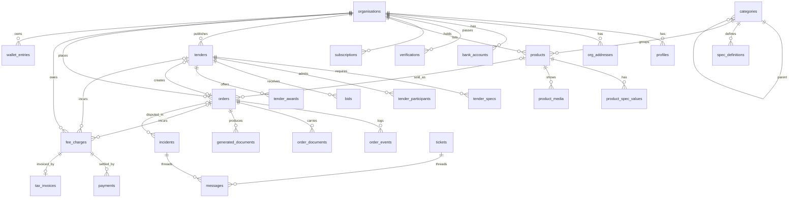

# Bid Market: Data Model

Source of truth: PRD.md and ARCHITECTURE.md.

## 1. Technology and conventions

- **Database:** PostgreSQL on Supabase, Mumbai region.
- **Primary keys:** `uuid`, generated with `gen_random_uuid()`, unless stated.
- **Time:** `timestamptz`, stored in UTC and displayed in IST.
- **Money:** `bigint` paise, with columns ending in `_paise`.
- **Rates:** `int` basis points, with columns ending in `_bps`. 0.1% = 10, 0.5% = 50, 18% = 1800.
- **Quantity:** `numeric(14,3)`.
- **Names:** `snake_case`. Plural tables.
- **Standard columns:** every mutable table has `created_at` and `updated_at`. Omitted from tables below.
- **Deletion:** business records are not deleted. Use status fields.
- **History:** snapshot prices, specifications and rates onto transactions.

## 2. Enums

| Enum | Values |
|---|---|
| `org_kind` | buyer, seller |
| `entity_type` | individual, proprietorship, partnership, trust_society, llp, company |
| `org_status` | draft, pending_payment, pending_review, active, suspended, rejected |
| `user_role` | org_user, admin |
| `product_status` | draft, pending, notify, published, unpublished, rejected |
| `tender_type` | bid, ra, bid_to_ra |
| `tender_kind` | regular, custom |
| `tender_status` | draft, unpaid, bidding, evaluating, shortlisting, auction_scheduled, auction, awarding, ordered, cancelled |
| `award_status` | pending, offered, accepted, rejected, expired |
| `order_source` | direct, tender |
| `order_status` | unpaid, awaiting_seller, accepted, dispatched, completed, cancelled |
| `payment_terms` | advance, on_delivery, credit |
| `charge_kind` | direct_buyer, direct_seller, tender_buyer, tender_deposit, tender_balance, tender_seller, subscription |
| `charge_status` | pending, held, paid, released, cancelled |
| `wallet_bucket` | available, on_hold, paid |
| `payment_status` | created, paid, failed |
| `verification_kind` | pan, gstin, bank, cin, identity |
| `verification_status` | pending, verified, failed, manual_review |
| `case_status` | open, in_review, closed |
| `file_scan_status` | pending, clean, infected |
| `job_status` | pending, running, done, failed |

## 3. Tables

### 3.1 Identity

**organisations**

| Column | Type | Notes |
|---|---|---|
| id | uuid | PK |
| kind | org_kind | Not null |
| entity_type | entity_type | Sellers cannot be `individual`, enforced by check |
| legal_name | text | Not null |
| pan_enc | bytea | Encrypted |
| pan_hmac | bytea | Unique per kind, used for duplicate checks |
| pan_last4 | text | Display |
| gstin | text | 15-character format check. Required for sellers |
| cin_llpin | text | Nullable |
| incorporated_on | date | Nullable |
| status | org_status | Default draft |
| maintenance | boolean | Default false |
| strike_count | int | Default 0 |
| blocked_until | timestamptz | `infinity` for permanent |
| strikes_reset_at | timestamptz | Nullable |

**profiles**

| Column | Type | Notes |
|---|---|---|
| user_id | uuid | PK, FK `auth.users` |
| org_id | uuid | FK organisations. Null for admins and for new users before onboarding. One user per organisation in MVP |
| role | user_role | Default org_user |
| full_name, designation | text | |
| phone, email | text | Copied from Auth, unique |
| theme | text | light, dark or system |

Admin rows are created only by invitation.

**consents:** `id`, `user_id` FK, `purpose` text, `policy_version` text, `accepted_at`, `withdrawn_at`.

**org_addresses:** `id`, `org_id` FK, `label`, `line1`, `line2`, `city`, `state_code` char(2), `pincode` char(6), `is_registered` boolean. Immutable after insert.

**bank_accounts:** `id`, `org_id` FK, `holder_name`, `account_no_enc` bytea, `account_last4`, `ifsc`, `is_primary` boolean, `verified_at`. Immutable after insert, except `is_primary`. Partial unique index allows one primary per organisation.

**verifications:** `id`, `org_id` FK, `kind`, `status`, `provider`, `provider_ref`, `result` jsonb (masked fields only, never raw identity documents), `reviewed_by` FK profiles, `checked_at`.

**turnover_declarations:** `id`, `org_id` FK, `financial_year` text, `amount_paise`. Unique (`org_id`, `financial_year`).

**otp_attempts:** `id`, `phone_or_email_hmac` bytea, `purpose`, `sent_at`, `resend_count`, `locked_until`. Purged after 7 days.

### 3.2 Catalogue

**categories:** `id`, `parent_id` FK self, `name`, `slug` unique, `description`, `is_active`, `sort_order`.

**spec_definitions:** `id`, `category_id` FK, `key`, `label`, `kind` (text, number, enum), `unit`, `allowed_values` jsonb, `min_value`, `max_value` numeric, `is_key` boolean, `is_required` boolean. Unique (`category_id`, `key`). A sub-category uses its own specifications and those of its main category.

**category_requests:** `id`, `seller_org_id` FK, `name`, `details`, `status` (pending, approved, rejected), `review_note`, `reviewed_by` FK profiles. A catalogue file can be added with document uploads.

**products**

| Column | Type | Notes |
|---|---|---|
| id | uuid | PK |
| display_no | text | Unique, such as BMP-000123 |
| seller_org_id | uuid | FK organisations |
| category_id | uuid | FK categories |
| title | text | Not null |
| description | text | |
| search | tsvector | Generated, GIN indexed |
| mrp_paise | bigint | Greater than 0 |
| discount_bps | int | Between 0 and 9000. Minimum checked against settings at submission |
| net_paise | bigint | Generated from MRP and discount |
| stock_qty | numeric(14,3) | At least 0 |
| unit | text | Not null |
| status | product_status | Default draft |
| review_note | text | |
| order_count | int | Default 0 |

**product_states:** PK (`product_id`, `state_code`).

**product_spec_values:** PK (`product_id`, `spec_definition_id`), `value_text`, `value_number`.

**product_media:** `id`, `product_id` FK, `storage_path` unique, `sort_order`. Submission requires 3 images, and 3 is also the maximum. Video is not built.

### 3.3 Tenders

**tenders**

| Column | Type | Notes |
|---|---|---|
| id | uuid | PK |
| tender_no | text | Unique, such as BM/26/RA/00412 |
| buyer_org_id | uuid | FK organisations |
| type | tender_type | |
| kind | tender_kind | |
| status | tender_status | Default draft |
| product_id | uuid | FK products. Required for regular tenders |
| category_id | uuid | FK categories |
| title | text | Snapshot |
| quantity | numeric(14,3) | Greater than 0 |
| unit | text | |
| estimate_unit_paise | bigint | Greater than 0 |
| payment_terms | payment_terms | D-1 |
| credit_days | int | Required when terms are credit |
| consignee_name, consignee_gstin | text | GSTIN format check |
| consignee_address_id | uuid | FK org_addresses |
| delivery_state_code | char(2) | |
| contract_months | int | |
| terms_file_id | uuid | FK files, nullable |
| bid_starts_at, bid_ends_at | timestamptz | Null for pure RA |
| bid_opens_at | timestamptz | Null for pure RA |
| ra_starts_at, ra_ends_at | timestamptz | Null for pure bid |
| min_bids | int | At least 1 |
| extensions_allowed | int | Default 0 |
| extensions_used | int | Default 0 |
| extension_minutes | int | |
| snipe_extensions_used | int | Default 0, capped by settings |
| l1_paise | bigint | Current lowest valid price, maintained under the row lock |
| bid_count | int | Default 0 |
| seq | bigint | Increments with each auction change |
| cancel_reason | text | |
| settings_id | uuid | FK platform_settings |

Check constraints ensure the terms and tender kind fit. Phase 6 builds `bid_starts_at`, `bid_ends_at`, `extensions_used` and the shared fields. The auction columns (`bid_opens_at`, `ra_*`, `snipe_extensions_used`, `l1_paise`, `bid_count`, `seq`), and `terms_file_id`, arrive with Phases 7 and 8 and later file work. Buyers see bids once `bid_ends_at` passes and the tender is `evaluating`.

**tender_specs:** `id`, `tender_id` FK, `spec_definition_id` FK nullable, `label`, `value`, `unit`, `is_key`. Snapshot of required specifications.

**tender_participants**

| Column | Type | Notes |
|---|---|---|
| tender_id | uuid | PK part, FK |
| seller_org_id | uuid | PK part, FK |
| attempts_used | int | Maximum 3 for sealed bids |
| last_bid_paise | bigint | Nullable. Latest active bid |
| last_bid_at | timestamptz | Breaks ties, with the earlier bid ranked first |
| withdrawn | boolean | Default false |
| eliminated_at | timestamptz | Set in Bid to RA |
| declined_at | timestamptz | Set when an award is rejected |

**bids:** append-only.

| Column | Type | Notes |
|---|---|---|
| id | uuid | PK |
| tender_id | uuid | FK |
| seller_org_id | uuid | FK |
| phase | text | sealed or auction |
| unit_paise | bigint | Greater than 0 |
| withdrawn_at | timestamptz | Sealed bids only |
| idempotency_key | text | Unique (`seller_org_id`, `idempotency_key`) |
| placed_at | timestamptz | Set by the server inside the transaction |

**tender_awards:** `id`, `tender_id` FK, `seller_org_id` FK, `rank` int, `unit_paise`, `status`, `offered_at`, `expires_at`, `responded_at`, `reject_reason`. A partial unique index allows one open award per tender. `pending` means a custom tender balance is still due.

### 3.4 Orders

**orders**

| Column | Type | Notes |
|---|---|---|
| id | uuid | PK |
| order_no | text | Unique, such as BMO-26-001042 |
| source | order_source | |
| tender_id | uuid | FK, required for tender orders |
| product_id | uuid | FK, nullable |
| buyer_org_id, seller_org_id | uuid | FK organisations |
| title, unit | text | Snapshot |
| spec_snapshot | jsonb | Snapshot |
| quantity | numeric(14,3) | |
| unit_paise, total_paise | bigint | |
| payment_terms | payment_terms | |
| credit_days | int | |
| expected_delivery_on | date | Direct orders, at least 5 days after creation |
| consignee_name, consignee_gstin | text | |
| delivery_address | jsonb | Snapshot |
| status | order_status | |
| contacts_unlocked_at | timestamptz | Set after seller accepts and pays |
| settings_id | uuid | FK platform_settings |

**order_events:** `id`, `order_id` FK, `status`, `actor_id`, `note`, `created_at`. Append-only.

**order_documents:** `id`, `order_id` FK, `kind` (product_bill, eway_bill, transport_bill, delivery_proof), `file_id` FK nullable, `reference_no`, `not_applicable_reason`. One per kind per order. Check: needs a file or a reason. A product bill always needs a file (D-13).

**generated documents:** no table. Contracts, acceptance reports and received invoices are built on request from the frozen order record and its events, so every download is identical (decision 0006).

### 3.5 Billing

**platform_settings:** insert-only. The latest row by `effective_from` applies to new transactions.

Columns: `id`, `effective_from`, `direct_fee_bps`, `tender_fee_bps`, `gst_bps`, `tds_bps`, `limit_individual_paise`, `limit_org_paise`, `custom_deposit_paise`, `min_discount_bps`, `subscription_base_paise`, `subscription_base_crore`, `subscription_step_paise`, `decrement_bps`, `snipe_window_minutes`, `snipe_max`, `award_window_hours`, `free_subscription_sellers`, `supplier_legal_name`, `supplier_gstin`, `supplier_state_code`, `created_by`. `free_subscription_sellers` applies D-3: the first N sellers get a free first year.

Seed values: 10, 50, 1800, 0, ₹20,000, ₹50,000, ₹1,000, 1000, ₹25,000, 25, ₹100, 50, 5, 6, 48. TDS stays at 0 until your chartered accountant confirms it (D-12). The 48-hour award window is an assumption.

**fee_charges**

| Column | Type | Notes |
|---|---|---|
| id | uuid | PK |
| org_id | uuid | FK |
| kind | charge_kind | |
| order_id, tender_id, subscription_id | uuid | Exactly one set, by check. The first two gain foreign keys in Phases 5 and 6 |
| base_paise | bigint | |
| rate_bps | int | |
| fee_paise | bigint | Before tax |
| cgst_paise, sgst_paise, igst_paise | bigint | |
| tds_paise | bigint | Default 0 |
| total_paise | bigint | |
| status | charge_status | |
| settings_id | uuid | FK |

**payments:** `id`, `org_id` FK, `charge_id` FK, `provider`, `provider_order_id` unique, `provider_payment_id` unique, `amount_paise`, `status`, `failure_reason`.

**wallet_entries:** append-only. `id`, `org_id` FK, `charge_id` FK nullable, `from_bucket`, `to_bucket`, `amount_paise` greater than 0, `reason`, `created_at`. Balance is calculated from this table.

**tax_invoices:** `id`, `invoice_no` unique, `financial_year`, `org_id` FK, `charge_id` FK unique, `snapshot` jsonb, `issued_at`. The snapshot holds the invoice as issued, and the PDF is built from it on request. Numbers come from `number_sequences`, without gaps.

**subscriptions:** `id`, `org_id` FK, `turnover_paise` (total of the latest three years), `fee_paise`, `starts_on`, `ends_on`, `status` (pending, active, expired, cancelled), `settings_id` FK. Partial unique indexes allow one active and one pending per organisation. An expired seller returns to `pending_payment`, which hides listings until renewal.

**number_sequences:** PK (`name`, `financial_year`), `next_value`. Row-locked when issued.

### 3.6 Governance and system

**files:** `id`, `bucket`, `path` unique, `owner_org_id` FK, `uploaded_by` FK, `mime_type`, `size_bytes`, `sha256`, `scan_status`. Re-encoded images start clean. PDFs start pending and stay hidden from the other party until scanned.

**incidents:** `id`, `ref_no` unique, `raised_by_org_id` FK, `against_org_id` FK nullable, `product_id`, `tender_id`, `order_id` FK (at least one required), `description`, `status`, `decision`, `decided_by` FK, `decided_at`.

**tickets:** `id`, `ref_no` unique, `user_id` FK, `type`, `subcategory`, `description`, `status`, `resolution`, `assigned_to` FK.

**messages:** `id`, `incident_id` or `ticket_id` FK (exactly one), `author_id` FK, `body`, `file_id` FK nullable, `created_at`. Append-only.

**penalties:** `id`, `org_id` FK, `tender_id` FK nullable, `strike_no`, `days` nullable for permanent, `ends_at`, `reason`, `applied_by` FK nullable, `waived_by` FK, `waived_reason`, `waived_at`.

**outbox:** `id`, `channel` (email, sms), `template`, `recipient_user_id` FK, `payload` jsonb, `status`, `attempts`, `next_attempt_at`, `dedupe_key` unique, `last_error`.

**jobs:** not built. `tick_tenders` and billing jobs run directly from the job route, so this table waits until a job needs its own queue. `id`, `kind`, `payload` jsonb, `status`, `attempts`, `run_after`, `last_error`, `dedupe_key` unique.

**webhook_events:** `id`, `provider`, `event_id`, `event_type`, `received_at`, `processed_at`, `error`. Unique (`provider`, `event_id`).

**idempotency_keys:** PK (`user_id`, `key`), `route`, `request_hash`, `response_status`, `response_body` jsonb, `created_at`. Keyed by user because new users have no organisation yet.

**rate_counters:** PK (`user_id`, `window_start`), `hits`.

**audit_log:** append-only. `id` bigserial, `actor_id`, `actor_role`, `org_id`, `action`, `entity_type`, `entity_id`, `before` jsonb, `after` jsonb, `reason`, `ip`, `request_id`, `created_at`. Sensitive fields are masked.

## 4. Relationships

## 5. Key constraints

Enforced by check constraint, unique index or transition function:

- **Tender states:** only valid transitions are allowed, through functions.
- **One live offer:** one `offered` award per tender.
- **One order per tender:** unique partial index on `orders.tender_id`.
- **Direct order limit:** checked against `limit_individual_paise` or `limit_org_paise`.
- **Delivery date:** at least 5 days after creation.
- **Sealed attempts:** at most 3 per seller per tender.
- **Auction decrement:** price at or below `l1_paise × (1 − decrement_bps/10000)`. A first bid needs only to be positive.
- **Time:** every bid check uses server time inside the transaction.
- **Stock:** direct orders reduce `stock_qty` in the same transaction, with no negative stock.
- **Immutable records:** triggers block UPDATE and DELETE on `bids` (except `withdrawn_at`), `order_events`, `wallet_entries`, `messages`, `audit_log`, `platform_settings` and `tax_invoices`.

**Subscription formula (D-14):** `base + max(0, floor(turnover in crore − 25)) × step`. ₹25.5 crore pays ₹25,000. ₹40 crore pays ₹26,500.

## 6. Indexes

Each index supports a named query.

| Query | Index |
|---|---|
| Catalogue by category | `products (category_id, status, order_count DESC)` |
| Catalogue text search | GIN on `products.search`, trigram on `title` |
| Filter by state | `product_states (state_code, product_id)` |
| Filter by specification | `product_spec_values (spec_definition_id, value_text)` and `value_number` |
| Seller's products | `products (seller_org_id, status)` |
| Public open tenders | `tenders (status, bid_ends_at)` and `tenders (status, ra_ends_at)` |
| Tenders by category for eligibility | `tenders (category_id, status)` |
| Tick finds due tenders | Partial on `tenders (ra_ends_at)` for `auction`, and `(bid_ends_at)` for `bidding` |
| Buyer's tenders | `tenders (buyer_org_id, status, created_at DESC)` |
| Bid history | `bids (tender_id, placed_at)` |
| Ranking | `tender_participants (tender_id, last_bid_paise)` |
| Seller's applied tenders | `tender_participants (seller_org_id)` |
| Open award expiry | Partial on `tender_awards (expires_at)` for `offered` |
| Orders by party | `orders (buyer_org_id, status, created_at DESC)` and `(seller_org_id, status, created_at DESC)` |
| Wallet | `wallet_entries (org_id, created_at DESC)` |
| Admin queues | Partial on `organisations (status)`, `products (status)`, `incidents (status)`, `tickets (status)` |
| Outbox and jobs | Partial on `(next_attempt_at)` and `(run_after)` for pending rows |
| Audit lookup | `audit_log (entity_type, entity_id, created_at DESC)` |

## 7. Ownership and row-level security

RLS is enabled on every table in `public`. Helper functions `current_org_id()` and `is_admin()` read `profiles` for `auth.uid()`.

| Table group | Anonymous | Buyer or seller | Admin |
|---|---|---|---|
| Categories, specifications | Read active | Read active | Read and write through functions |
| Products | Read published, without seller identity | Same, plus own all | Read all |
| Tenders | Read public fields of open tenders | Same, plus own all | Read all |
| Bids | None | Own only. Buyer reads sealed bids only after `bid_opens_at`, and auction bids only after closure | Read after close, or logged access to auction prices (D-9) |
| Participants | None | Own row. Owning buyer after close | Read all |
| Orders, order documents | None | Through `get_order` and `list_orders` only, with consignee and address masked until contacts unlock | Through `get_order` |
| Billing, wallet | None | Own organisation | Read all |
| Identity tables | None | Own organisation, masked | Read through functions, logged |
| Incidents, messages | None | Parties only | Read all |
| Tickets | None | Own | Read all |
| Audit log, jobs, outbox, webhook_events | None | None | Audit log read only |

**Public reads.** Anonymous catalogue reads use the `search_products` and `public_product` functions, and tender reads will use the same pattern. These return only allow-listed columns and exclude seller or buyer identity as PRD section 6 requires. The tables grant nothing to visitors.

**Contact visibility.** The other party's name and contact details come only through `get_order_contacts()`, which returns nothing until `contacts_unlocked_at` is set.

**Realtime.** Policies on `realtime.messages` allow a join on `ra:{id}:sellers` only with a non-eliminated `tender_participants` row, and on `ra:{id}:buyer` only for the owning buyer.

**Writes.** No write grants on business tables for `anon` or `authenticated`. Functions check ownership and status. Every `SECURITY DEFINER` function sets a safe `search_path`.

## 8. Sensitive data

| Data | Handling |
|---|---|
| Bank account number, PAN | Encrypted with pgcrypto AES-256 inside Postgres functions. Keys stay in Supabase Vault. Key rotation still needs a procedure. |
| Aadhaar | Never stored. Provider returns a pass or fail reference (D-4). |
| Passwords, OTPs | Handled by Supabase Auth. OTP is never logged. |
| Provider responses | Masked fields only. Raw responses are not stored. |
| Uploaded documents | Private buckets, short-lived links. |
| Audit log | Mask secrets and identity values before writing. |

## 9. Migrations and seed data

- Use forward-only SQL migrations, named with a timestamp and description.
- Expand first, migrate data, then contract in a later release.
- A migration must be safe while auctions run. Avoid long table locks.
- Run pgTAP tests in CI on every migration.
- **Seed for all environments:** categories, specification templates, first `platform_settings` row, document sequences.
- **Seed for local and preview only:** example organisations, products and tenders, using invented names and `.example` emails. Never seed these in production.

Production categories follow D-6: all 16 main categories and their sub-categories are live.

**Migration history note.** `20261104001200_direct_orders` and `20261104001300_sealed_tenders` were run by the owner in the Supabase SQL editor, so they are live but missing from the Supabase migration list. Treat them as applied.

## 10. Backup and recovery

- Enable point-in-time recovery on production. Proposed targets: RPO 5 minutes, RTO 4 hours. `[ASSUMPTION]`
- Take a daily logical dump to separate storage, encrypted, in India.
- Back up storage buckets on a schedule, as they are not included in database backups by default. Verify this at setup.
- Test a restore every quarter, and before launch.
- Retention follows D-15. Retention periods are not defined until your lawyer and chartered accountant confirm them.
